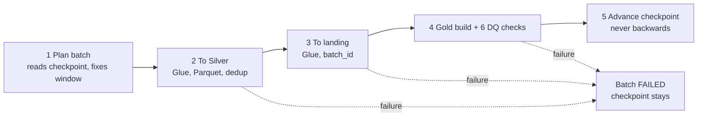
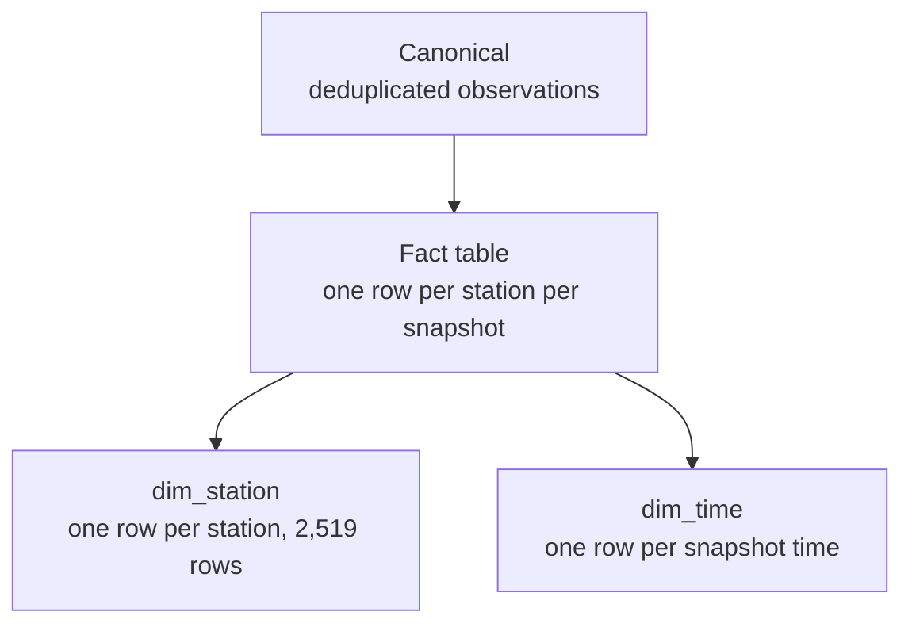
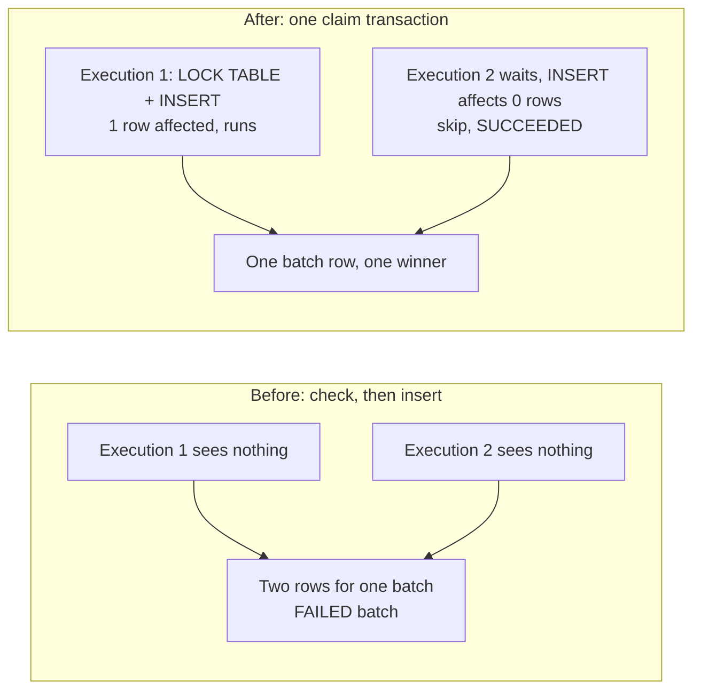
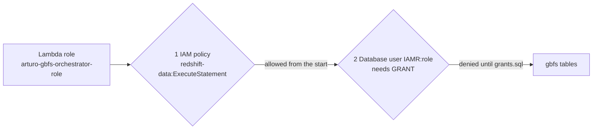

# Homework answers: Automated Incremental AWS Data Pipeline

Source: Citi Bike GBFS feed. All numbers below come from my own runs on Oct 15, 2026
(evidence files are in `evidence/`).

## 1. Why is incremental processing more efficient than full refreshes, and when might a full refresh still be appropriate?

An incremental run only does work proportional to the new data, while a full refresh repeats work proportional to everything collected so far. My first batch (b20261015T140000Z) had to load 342,584 rows because it started from nothing. Every later batch added only 15,114 fact rows (6 snapshots x 2,519 stations), even though the table keeps growing. A full refresh gets slower every day, costs more Glue time and rewrites unchanged data.

| Run | Rows touched | What it scanned |
|---|---|---|
| First batch (b...140000Z) | 342,584 | everything since the boundary |
| Later batches (b...143000Z) | 15,114 new fact rows | the window: 2 h overlap + new 30 min |
| Repeat with nothing new | 0 | planner printed "Nothing new to process" |

A full refresh is still right when the transformation logic or schema changes and old results are wrong, when the checkpoint or batch history can no longer be trusted, when the source rewrites history, or when the data is small enough that incremental logic is not worth the complexity. Bronze keeps the raw files, so a full rebuild is always possible.

## 2. Why should a checkpoint advance only after the Gold layer has been successfully updated?

The checkpoint is a promise: everything before this boundary is already in Gold and has passed its checks. If it moved earlier (for example after Silver) and the Gold build then failed, the next run would start after the failed window, those records would never be loaded and nothing would raise an error. Moving it last turns a failure into a retry.



Test: with `FAIL_AT=after_process` the run crashed after the star-schema build. Batch b20261015T150000Z was marked FAILED, the checkpoint stayed at 14:30Z and the fact table held 372,812 rows. The rerun reused the same batch id and window, completed, moved the checkpoint to 15:00Z and left the fact count at 372,812. The advance is also guarded (`last_window_end < window_end`), so it can never go backwards. Evidence: `run_batch_3_failed.log`, `run_batch_3_recovery.log`.

## 3. Explain the difference between Glue bookmarks and an application-managed checkpoint.

A Glue bookmark is state Glue keeps inside one job: which input files that job already read. It only knows about that job, marks input consumed when the job succeeds even if a later stage fails, cannot express an overlap window, and redoing a period means resetting the whole bookmark.

An application-managed checkpoint is state I own. Mine lives in Redshift (`gbfs.pipeline_checkpoint` and `gbfs.batch_log`) and records the end of the last window that reached Gold and passed its checks.

| | Glue bookmark | My checkpoint |
|---|---|---|
| Where it lives | inside Glue, per job | Redshift table, whole pipeline |
| What it tracks | input files already read | last window fully through Gold and checks |
| Advances when | the job run succeeds | only after Gold and data quality checks |
| Overlap and retry same window | not supported | built in (batch_id and window) |
| Visibility | limited | `SELECT * FROM gbfs.pipeline_checkpoint` |

The trade-off is that I had to build and test the logic myself (including the race in question 8), but that control is what makes safe recovery possible.

## 4. How does overlapping processing help with late-arriving records? What new problem does it introduce?

A record can reach Bronze after the window it belongs to was processed (feed delays, retried Lambda). With strict windows it falls into a window marked complete and is never loaded. My planner starts every window 2 hours before the checkpoint, so later batches pick up late records. Windows are half-open, [start, end), so neighbouring windows never double-count or miss a boundary record.

```
12:00      12:30      13:00      14:00      14:30      15:00
 |----------|----------|----------|----------|----------|
 [== b20261015T143000Z: 12:00 -> 14:30 ======]
            [== b20261015T150000Z: 12:30 -> 15:00 ======]
            ^^^^^^^^^^^^^^ 2 hours read by both batches ^^^^
```

The new problem is that each observation is read many times. The pipeline handles it at three levels: Silver drops duplicates on the logical key (station and snapshot time), the canonical load only inserts rows that do not exist yet (NOT EXISTS), and the fact table is built from canonical. That is why b20261015T143000Z read 12:00 to 14:30 but added only 15,114 new fact rows. Limit of the policy: a record more than 2 hours late is not picked up.

## 5. Explain the difference between an idempotent pipeline and one that guarantees each physical operation executes exactly once.

Exactly-once execution means every physical operation (each Lambda call, Glue run, INSERT) happens one time. That is very hard on AWS: Step Functions can retry, a Glue job can be started twice, a Lambda can time out after writing some data. My pipeline is at-least-once on purpose and makes repeats harmless, which is what idempotent means: running the same step again with the same input leaves the same final state.

It comes from four things: a deterministic batch_id and window so a retry works on the same input; batch-scoped loads that remove that batch's rows before inserting; stable business keys with NOT EXISTS in canonical; and a star-schema build replaced inside one transaction. Evidence: reprocessing batch test-002 left canonical at 68,013, dim_station at 2,519, dim_time at 3 and fact at 68,013; recovery of b20261015T150000Z left the fact table at 372,812 rows before and after; a repeat run printed "Nothing new to process".

## 6. Why is a landing table useful between Glue and the canonical Redshift table?

It is a buffer between loading and trusted data. Glue writes the whole Silver batch into landing, tagged with its batch_id, and only then does SQL inside Redshift decide what moves on. That separates two failure types: getting data into Redshift (network, credentials, format) and deciding what belongs in canonical (business keys).

Because every landing row has a batch_id I can delete and reload exactly one batch, and inspect a bad batch before it affects canonical or Gold. Canonical never receives a half-loaded batch, and Redshift does the set-based work (joins, NOT EXISTS), which is faster and easier to test than row-by-row logic in Glue.

## 7. Why should a fact table have a clearly defined grain before its schema is designed?

The grain says what one row means. Mine: one row per station per snapshot (one station's bike availability at one point in time). Everything follows from it: the columns I can store are only those true at that grain, the dimensions are station and time, and the duplicate check is simple (the pair station + snapshot must be unique). Without a grain, rows mean different things and sums and counts quietly give wrong answers.



The grain also gave me numbers to check: a batch with 6 snapshots over 2,519 stations must add 6 x 2,519 = 15,114 fact rows, and it did. Two duplicate checks and two orphan checks returned 0 after every batch (`dq_*.txt`). Dimensions are loaded before the fact so every fact row finds its station and time.

## 8. What happens if two Step Functions executions read the same checkpoint simultaneously? How would you prevent incorrect results?

Both compute the same window and batch, both load it, and results can be duplicated or corrupted. I hit this for real. My first design checked the batch log and then inserted a row as two separate steps. While the Redshift workgroup was cold-starting, two executions ran the check at the same moment, both saw nothing running, and both inserted a row. Result: duplicate rows for batch b20261015T173000Z, a Glue concurrency failure (Glue allows one run of a job at a time, so it acted as a lucky backstop), a FAILED batch and an AdvanceCheckpoint error ("single-row subquery returns more than one row"). The checkpoint did not move; I repaired the duplicate with a one-time SQL script and a new execution completed the batch.



The fix is to make check and claim one atomic step: a single Redshift transaction with `LOCK TABLE gbfs.batch_log` followed by a conditional INSERT (or UPDATE for a retry). The execution that gets 1 row affected owns the batch; the one that gets 0 skips. A batch STARTED for more than 45 minutes is treated as dead and can be taken over. Verified: two executions started 2 seconds apart, one ran b20261015T180000Z to COMPLETED, the other ended SUCCEEDED with `skip: true` and the same batch id, and the duplicate-batch query returned 0 (`overlap_duplicate_check.txt`, `stepfunctions_executions.txt`). A check followed by an action is a race; the database has to make them one operation.

## 9. Why might a Lambda have `redshift-data:ExecuteStatement` permission but still receive a database permission denied error?

There are two independent permission systems. The IAM policy on the Lambda role decides whether AWS lets the Lambda call the Redshift Data API. Once accepted, Redshift runs the SQL as a database user, and the database decides on its own, using GRANTs, whether that user may use a schema and its tables.



This happened to me: the first run failed with `permission denied for schema gbfs`. A Lambda connecting through its IAM role runs as the database user `IAMR:<role name>` (the `IAM:` prefix is for IAM users), so my first grants went to the wrong user. `sql/grants.sql` removed the wrong user and granted USAGE on schema gbfs and SELECT, INSERT, UPDATE, DELETE on its tables to `IAMR:arturo-gbfs-orchestrator-role`. That keeps least privilege in both layers.

## 10. Why does a successful Terraform apply not prove that a pipeline is operationally correct?

Terraform only proves the resources I described exist and match the configuration. It does not run the pipeline or see what happens inside it. Three of my incidents show this. First, I accidentally emptied `lambda/plan_batch.py`; Terraform packaged the empty file and applied cleanly, but the first execution failed after 3 seconds. I now run `wc -l lambda/*.py` before every plan. Second, the Lambda role had the right IAM policy and the apply succeeded, but the database refused it until the correct GRANTs were added (question 9). Third, a plain `terraform apply` turned my 30-minute schedule back on because the variable default was `true`; the infrastructure did exactly what the code said while spending money I did not intend. I changed the defaults to `false` and switch schedules with `-var`.

The real proof is behavior: successful batches reaching Gold, a repeat run that adds nothing, a controlled failure that leaves the checkpoint in place, two scheduled runs without overlap, and data quality checks returning 0. Reviewing `terraform plan` (0 to destroy) is essential, but it is the start of verification, not the end.
